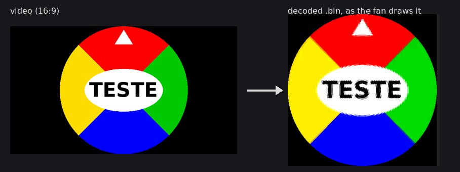
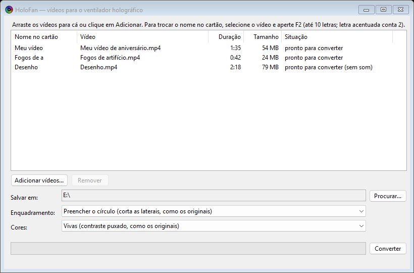

# HoloFan

Convert any video to the `.bin` format played by spinning-LED **"3D hologram" fans**: the kind with a
48-LED blade that draws the picture in the air. The software that came with the fan was lost, so the
format was reverse-engineered from the files on its memory card ([docs/FORMAT.md](docs/FORMAT.md)).

*Em português: [mais abaixo](#em-português).*



## Download

Get `HoloFan-<version>-win-x64.zip` from [Releases](../../releases), unzip it anywhere and run
`HoloFan.exe`. It contains `ffmpeg.exe`, which reads the videos; keep both files together. Windows 10/11
x64, nothing to install. The interface is in Portuguese.



## Use

1. Drag videos onto the window (or **Adicionar vídeos...**). Anything ffmpeg opens works: mp4, mkv, webm,
   avi, mov, gif…
2. **Salvar em** (save to) defaults to the memory card: the first removable drive that already has `.bin`
   files.
3. Click **Converter**. A tray notification says when they're done.

- **Nome no cartão**: the file name on the card, cut to 10 bytes like the originals (F2 renames). An
  existing file is never replaced; a taken name becomes `Name 2`.
- **Enquadramento**: *Preencher o círculo* crops a center square (like the originals); *Vídeo inteiro*
  fits the whole frame inside the circle.
- **Cores**: *Vivas* boosts contrast like the originals; *Naturais* keeps the video's colors.
- One minute of video takes about 34 MB on the card and converts in a couple of seconds.

## Does my fan use this format?

Probably, if its `.bin` files start with the bytes `EE 37` and their size minus 100,000 leaves a remainder
of a few hundred bytes when divided by 28,600. To be sure, preview one with
[tools/holo_preview.py](tools/holo_preview.py) (`pip install numpy pillow`, then
`python holo_preview.py FILE.bin --wav`). If you see a round picture and hear the sound, it's the same
format. Fans with a different LED count use a different layout.

## Format in short

| | |
|---|---|
| File | header + N frames (N multiple of 20) + 100,000 zero bytes |
| Frame | 28,600 bytes, 20 per second: 300 lines × 90 bytes of picture + 1,600 bytes of audio |
| Line | one blade position (counter-clockwise from 3 o'clock): 5 bit planes × 48 LEDs × B, G, R; LED 0 is the outer one |
| Audio | unsigned 8-bit PCM, mono, 32 kHz |
| Header | `EE 37`, two bytes and an XOR-scrambled sequence of varying length; HoloFan reuses one from an original file |

Details in [docs/FORMAT.md](docs/FORMAT.md).

## Build

Needs the [.NET 8 SDK](https://dotnet.microsoft.com/download/dotnet/8.0). Building from Linux/WSL works
too (`EnableWindowsTargeting`).

```
cd src
dotnet publish -c Release -o publish
```

`publish/HoloFan.exe` is a single self-contained exe. Put an `ffmpeg.exe` next to it (or on the `PATH`),
for example from the [gyan.dev essentials build](https://www.gyan.dev/ffmpeg/builds/).

| File | What it does |
|---|---|
| `src/HoloFormat.cs` | format constants, the header, bit packing of a line, file-name rule |
| `src/PolarSampler.cs` | square frame (480×480) → 300 lines × 48 LEDs, averaging 4×4 points per ring segment; color curve |
| `src/VideoConverter.cs` | runs ffmpeg for the audio (`u8`, 32 kHz) and the picture (`rgb24`, 20 fps) and writes the `.bin` |
| `src/MainForm.cs` | the window |

## License

[MIT](LICENSE). The release zip bundles ffmpeg (gyan.dev essentials build, GPL v3); its license and
build notes are included in the zip, and its source is at [ffmpeg.org](https://ffmpeg.org/download.html).

---

## Em português

O HoloFan converte vídeos para o `.bin` dos ventiladores holográficos de LED (a hélice com 48 LEDs que
gira e desenha a imagem no ar). O programa que vinha com o aparelho se perdeu, então o formato foi
descoberto a partir dos arquivos do cartão de memória.

1. Baixe o `HoloFan-<versão>-win-x64.zip` em [Releases](../../releases), descompacte e abra o
   `HoloFan.exe`. O `ffmpeg.exe` precisa ficar na mesma pasta. Não precisa instalar nada.
2. Arraste os vídeos para a janela. O **Salvar em** já vem com o cartão de memória.
3. Clique em **Converter** e coloque o cartão no ventilador.

O nome no cartão tem até 10 letras (letra acentuada conta 2), como nos originais; F2 troca o nome. Um
arquivo que já está no cartão nunca é substituído. O formato está descrito (em inglês) em
[docs/FORMAT.md](docs/FORMAT.md).
